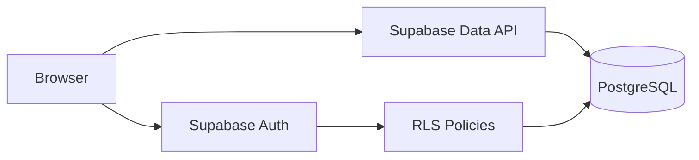

# SUSTech Campus Events

面向高校学生与活动组织者的校园活动报名与管理系统。项目目前提供经过脱敏的前端交互原型，下一阶段将接入 Supabase Auth、PostgreSQL 和 Row Level Security，形成可部署的全栈版本。

> 当前状态：`v0.1 sanitized prototype`。所有数据仅保存在浏览器内存中，刷新页面后会重置；README 不把这一版本描述为已经完成的 Supabase 系统。

## 项目来源与署名

- 项目最初源于 MIS205 三人课程团队项目。
- 三名成员共同参与需求分析、数据库设计和原型开发，并同意公开发布。
- 本仓库由 [@articbay](https://github.com/articbay) 维护，用于完成脱敏、工程化整理和个人全栈重构。
- 原始课程仓库：[HD-208/mis205-project2](https://github.com/HD-208/mis205-project2)

## 当前功能

- 校园身份三字段匹配演示
- 用户注册、登录和登出
- 活动列表、详情与多维筛选
- 创建、编辑和删除活动
- 报名、取消报名和人数上限判断
- “我组织的 / 我报名的”活动视图
- 响应式页面、轮播图和操作提示

## 演示身份

```text
姓名：演示学生A
学号：12400001
邮箱：12400001@mail.sustech.edu.cn
密码：自行设置，至少6位
```

该身份为虚构测试数据，不对应真实个人。

## 技术栈

当前原型：HTML5、CSS3、原生 JavaScript。

重构目标：Supabase Auth、Supabase PostgreSQL、Row Level Security、SQL migrations、pgTAP 测试和 GitHub Pages 部署。

## 计划中的系统架构



## 本地运行

可直接打开 `index.html`，或使用任意静态文件服务器运行仓库根目录。

## 全栈重构路线

- [x] 建立独立作品集仓库
- [x] 移除真实姓名、学号、邮箱、明文密码和日志
- [x] 合并冗余文件并修复基础前端校验
- [ ] 创建 Supabase 项目与数据库迁移
- [ ] 接入 Auth 注册、登录和邮箱确认
- [ ] 将活动与报名迁移到 PostgreSQL
- [ ] 配置并测试 RLS 权限
- [ ] 使用数据库函数处理并发报名与人数上限
- [ ] 部署在线演示并补充截图

## 安全说明

- 仓库不提交 `.env`、日志、真实人员名单或私密密钥。
- 浏览器端只允许使用 Supabase publishable key。
- `service_role` key 不得出现在前端或 GitHub 仓库中。
- 正式版本的身份验证和权限控制将在数据库端执行。

## License

三名课程项目成员已同意公开发布脱敏版本。本仓库采用 [MIT License](LICENSE)。
