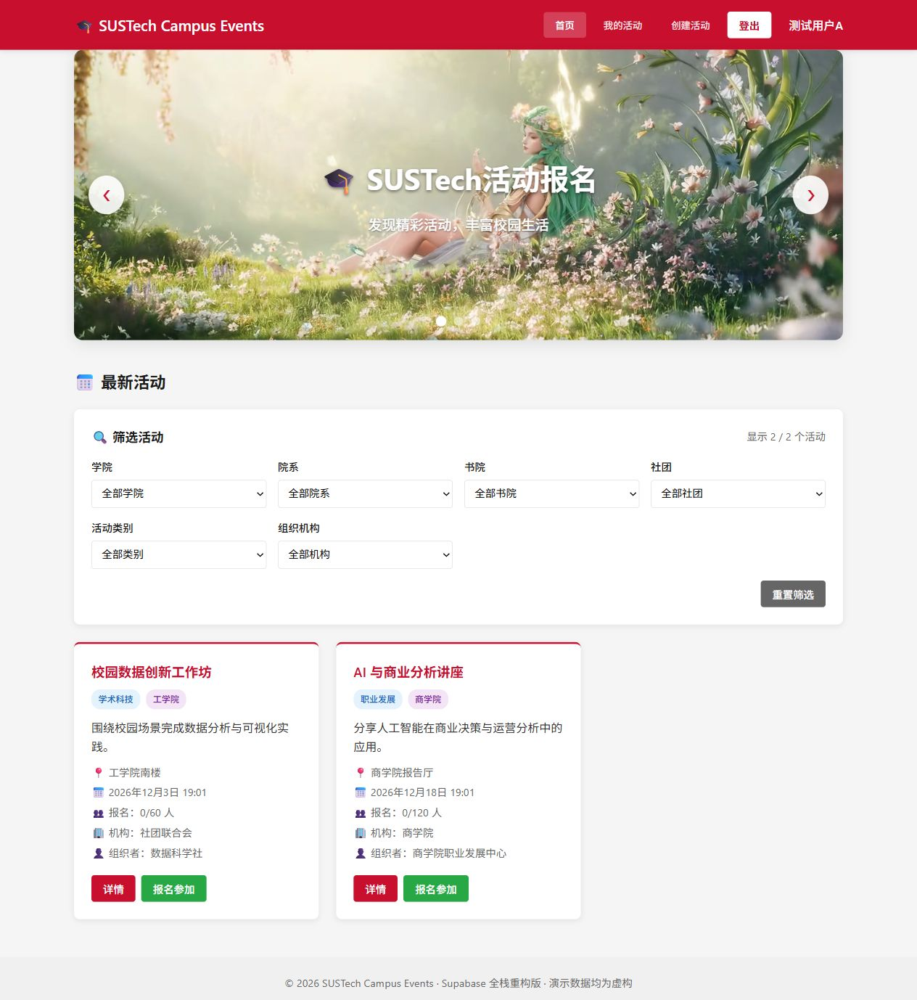
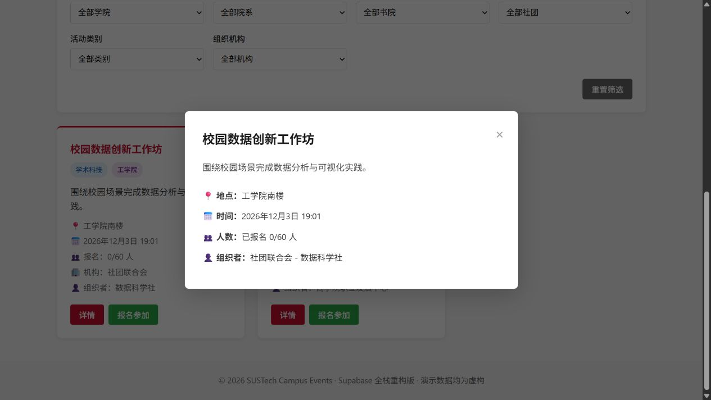
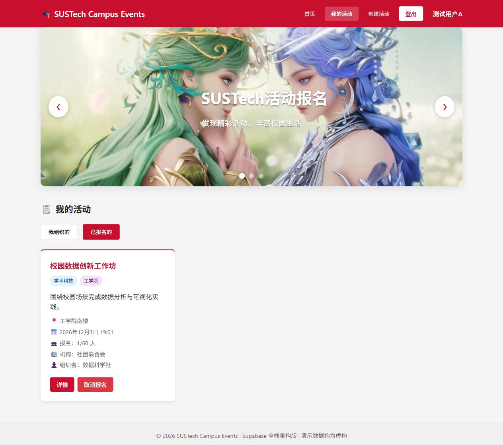
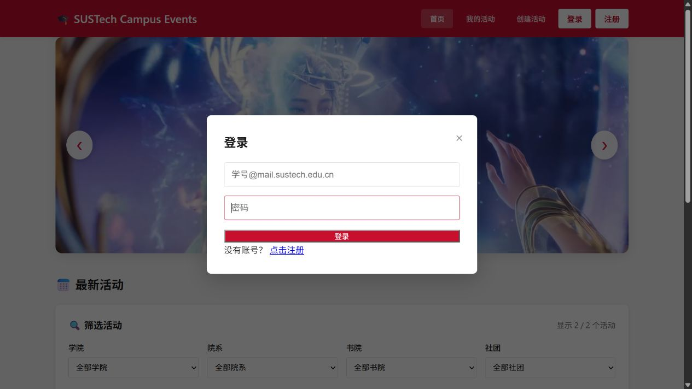
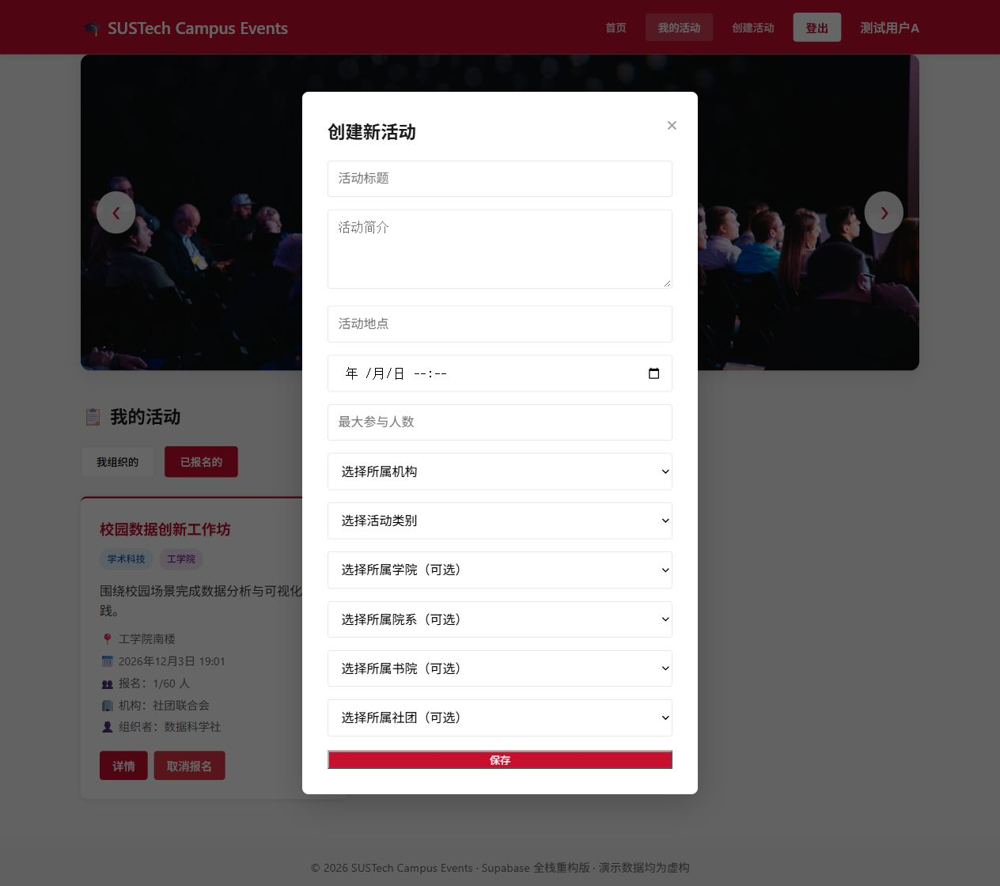
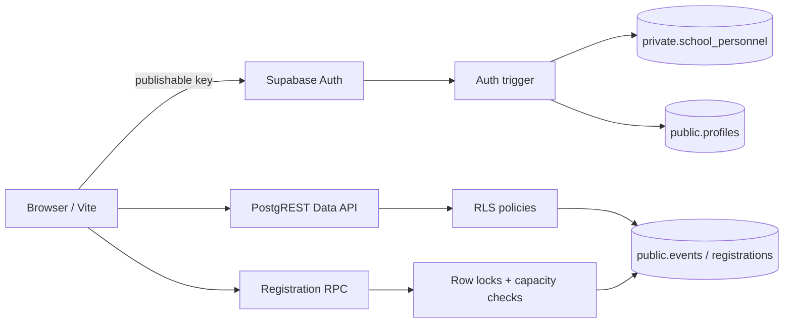

# SUSTech Campus Events

面向高校学生与活动组织者的校园活动报名与管理系统。项目已从 MIS205 课程前端原型重构为 Supabase 全栈应用，浏览器通过 `supabase-js` 调用 Auth、PostgreSQL Data API 和数据库函数；身份校验、数据权限与报名并发控制均在后端执行。

> 当前状态：`v0.2 full-stack beta`。线上 Supabase 数据库已接通，匿名读取、真实 Auth 注册登录、RLS 和登录态读写验收均已通过；尚未部署公开演示站点。

## 项目来源与署名

- 项目最初源于 MIS205 三人课程团队项目。
- 三名成员共同参与需求分析、数据库设计和原型开发，并同意公开发布脱敏版本。
- 本仓库由 [@articbay](https://github.com/articbay) 维护，用于完成脱敏、工程化整理和个人全栈重构。
- 原始课程仓库：[HD-208/mis205-project2](https://github.com/HD-208/mis205-project2)

## 项目时间线

- **2026 年 4—5 月：课程团队原型。** 三名成员共同完成需求分析、关系数据库设计和原生 HTML/CSS/JavaScript 前端原型；课程版本使用浏览器内存数据，不包含真实后端。
- **2026 年 9 月：个人全栈重构。** 仓库维护者独立完成脱敏、Supabase Auth 与 PostgreSQL 接入、RLS 权限策略、报名并发控制、数据库迁移、测试和 CI。
- **2026 年 11 月：公开前整理。** 补充脱敏系统截图，复查 Git 历史、依赖、数据库权限和公开安全性。

## 界面预览

以下截图来自本地前端连接 Supabase 测试项目的实际运行结果，账号和活动数据均为虚构内容。

| 首页与活动筛选 | 活动详情 |
| --- | --- |
|  |  |
| **已报名活动** | **登录界面** |
|  |  |

<details>
<summary>查看创建活动表单</summary>



</details>

## 已实现功能

- 从 Supabase PostgreSQL 实时读取、筛选和展示活动
- Supabase Auth 注册、登录、登出与会话恢复
- 注册时使用姓名、学号/工号、邮箱三字段匹配私有校园人员白名单
- 通过校园身份验证的用户可创建、编辑和删除本人活动
- 用户报名、取消报名和“我组织的 / 我报名的”活动视图
- 数据库函数以行锁串行化同一活动的报名操作，避免超额报名
- RLS 限制个人资料、活动草稿和报名记录的访问范围
- 响应式页面、详情弹窗、轮播图和操作提示

## 系统架构



### 数据模型

- `private.school_personnel`：不暴露给 Data API 的校园人员白名单。
- `public.profiles`：与 `auth.users` 一一对应的已验证用户资料。
- `public.events`：活动、组织者、容量、状态和分类信息。
- `public.registrations`：用户与活动的多对多报名关系。

完整建表、约束、索引、触发器、RLS 和数据库函数见 [`supabase/migrations`](supabase/migrations)。

## 本地运行

环境要求：Node.js 22.12 或更高版本。

```powershell
npm install
Copy-Item .env.example .env.local
npm run dev
```

在 `.env.local` 中填入自己的 Supabase Project URL 和 publishable key。浏览器端不得使用 `service_role` key。

常用检查：

```powershell
npm run build
npm run test:smoke
```

`test:smoke` 会以匿名客户端读取公开活动，确认 Data API、显式授权和 RLS 可以协同工作。

## 演示数据与账号

数据库迁移后的 `supabase/seed.sql` 只包含虚构人员和活动。示例白名单身份为：

```text
姓名：演示学生A
学号 / 工号：DEMO0001
邮箱：demo.student.a@example.invalid
```

`.invalid` 是保留域名，不会接收确认邮件；它用于验证数据结构，不是预先创建的公开体验账号。完整 Auth 验收使用了专用测试邮箱，该邮箱只保存在云端私有白名单与 Auth 中，不进入仓库。当前开发项目会自动确认新邮箱，公开部署前应开启邮箱确认并配置合适的 SMTP。

## 安全设计

- 仓库不提交 `.env.local`、真实人员名单、明文密码或私密密钥。
- 所有浏览器可访问的公开表均启用 RLS，并配合显式 Data API 权限。
- 白名单位于未暴露的 `private` schema，且撤销 `anon` 与 `authenticated` 权限。
- 注册资料由 Auth 触发器与白名单匹配后写入，前端不能自行伪造 profile。
- 报名和取消报名只允许已登录用户调用；函数固定空 `search_path`、校验 `auth.uid()`，并锁定活动行后修改人数。
- 正式部署前应开启邮箱确认、泄露密码防护，并提高最低密码强度。
- 仓库原有的 `guestbook` 示例表不属于本系统业务，当前重构未依赖或修改该表。

## 版本进度

- [x] 建立独立作品集仓库并完成团队署名
- [x] 移除真实姓名、学号、邮箱、明文密码和日志
- [x] 创建 Supabase 项目与可复现数据库迁移
- [x] 接入 Auth、PostgreSQL 持久化与 RLS
- [x] 使用数据库函数处理并发报名与容量上限
- [x] 完成本地构建、匿名 API 冒烟测试与页面验证
- [x] 增加 GitHub Actions 生产构建检查
- [x] 使用专用测试邮箱完成 Auth 注册、登录和写操作验收
- [x] 补充脱敏系统截图
- [ ] 可选：部署公开演示站点

## License

三名课程项目成员已同意公开发布脱敏版本。本仓库采用 [MIT License](LICENSE)。
